# 47 — Anesa ERP: 45–75-Day Pilot V1 Master Roadmap

**Status:** ACTIVE GOVERNING ROADMAP (2026-11-07).  
**Planning Window:** 45 to 75 calendar days to controlled first-school Pilot V1.  
**Governing Objective:** Deliver essential school operations for a controlled first-school pilot while strictly satisfying mandatory real-data security, privacy, and institutional data-control gates.  
**Authoritative Rule:** Do not replace this objective with an open-ended architecture, security, documentation, or frontend redesign programme. Core ERP development must progress in tandem with mandatory risk resolution.

---

## 1. Executive Summary and Allocation Strategy

Anesa ERP is being prepared for a controlled first-school pilot deployment. To balance operational viability with non-negotiable data-trust obligations, engineering effort is strictly allocated across three parallel tracks:

```
┌───────────────────────────────────────────────────────────────────────────┐
│                    PILOT V1 WORKLOAD ALLOCATION                          │
├─────────────────────────────┬──────────────────────────────┬──────────────┤
│ Track A: Core ERP (60%)     │ Track B: Security/Ops (30%)  │ Track C (10%)│
│  - Onboarding & First Admin │  - Privileged-Access Bounds  │  - E2E Tests │
│  - Students, Faculty, Staff │  - DB / Identity Isolation   │  - Rehearsals│
│  - Academics & Timetable    │  - Backups & Tested Restore  │  - Isolation │
│  - Attendance UI & Reports  │  - School Export & Offboard  │  - School    │
│  - Exams, Grades & Results  │  - Retention & Incident Prep │    Acceptance│
│  - Basic Fees & Dues        │  - Legal / DPDP Checklist    │              │
└─────────────────────────────┴──────────────────────────────┴──────────────┘
```

### Governing Constraints and Authority Bounds
1. **Pilot V1 Focus Only:** The target is a single participating school (or small controlled cluster), not an unrestricted commercial SaaS release.
2. **Preservation of Pending Acceptance:** Formal M3 acceptance (`docs/architecture/v3/40-m3-owner-acceptance-decision-sheet.md`) and M4 attendance acceptance (`docs/architecture/v3/43-m4-attendance-authorization-decision-sheet.md`) remain **PENDING** owner sign-off. Development continues on synthetic data.
3. **No Unauthorised Real Data:** This roadmap does **not** authorise processing real school personal data, running production migrations on live databases, or bypassing school principal acceptance.

---

## 2. Track A — Core ERP Functionality (60% Allocation)

| Component | Status | Priority | Repository Evidence | Critical Path Dependencies & Remaining Scope |
| :--- | :--- | :---: | :--- | :--- |
| **A1. Institution-Type Onboarding** | **PARTIAL** | **P0** | `backend/src/shared/settings/institution.ts`, `backend/src/modules/organization/settings.service.ts`, `apps/web/src/pages/AcademicSetupWizard.tsx`, `backend/tests/integration/institution-type.test.ts`, doc 44, doc 45 | Foundation implemented: setting `institution.type` (`SCHOOL`, `COLLEGE`, `UNIVERSITY`), role display labels (`Teacher`, `Principal`, `Vice Principal`), wizard step 1 UI. **Browser-verified 2026-11-07 (doc 49):** SCHOOL chosen in the wizard (step-up + reason), school preset saved, campus, department, period type, class and batch created, role labels correct, staff invited and granted FACULTY. **Missing:** formal school role templates (pending OD-I2), hierarchy presets (OD-I4), automatic terminology pre-population (OD-I5), and rehearsal of the later wizard steps (sections, curriculum, postings, timetable, holidays, term activation). |
| **A2. First-Administrator Activation** | **IMPLEMENTED AND VERIFIED (CLI)** | **P0** | `backend/tools/platform/first-admin.ts`, `backend/tests/integration/first-admin-onboarding.test.ts` (10/10), `docs/runbooks/first-administrator-onboarding.md` | Single-use hashed bootstrap tokens, mandatory MFA ticket creation (`mfa_enrollment_tickets`), audit logging, and local console output guard are fully verified. **Browser-verified 2026-11-07 (doc 49, 35/35):** operator provisions a synthetic school, single-use invitation redeemed in the browser, compliant password, operator MFA ticket, real TOTP enrolment, sign-in with MFA; negative cases (expired, reused, wrong tenant, duplicate bootstrap, invalid ticket/code, unauthorized setup, cross-tenant) all refused. Two web defects found and fixed. **Missing:** live transactional mailer (G4; the rehearsal used an in-memory stand-in), recovery for a lost authenticator, operator-run (not browser) provisioning remains by design. |
| **A3. Student & Guardian Management** | **IMPLEMENTED BUT NOT FULLY VERIFIED** | **P0** | `backend/src/modules/students/`, `database/migrations/0017`, `0021`, `0027`, `0035`, `apps/web/src/pages/StudentsPage.tsx`, `apps/web/src/pages/ImportsPage.tsx` | Full student lifecycle (APPLICANT → ACTIVE → COMPLETED), guardian links (primary constraint, max active), CSV imports with HMAC matching. **Missing:** Resolution of **PR-1** (must school provide individual student email logins or record-only student profiles?), minors' DPDP parental notice/consent flow, guardian self-service portal (deferred). |
| **A4. Faculty & Staff Management** | **IMPLEMENTED BUT NOT FULLY VERIFIED** | **P0** | `backend/src/modules/people/`, `database/migrations/0015`, `0020`, `apps/web/src/pages/AccessPage.tsx`, `backend/tests/integration/people.test.ts` | Employees, historical postings with single active primary posting guard, role assignment delegation rules, role admin UI. **Missing:** School teacher roles (Class Teacher and Subject Teacher exist only as assignments, not dedicated roles), faculty profile UI completion in web client. |
| **A5. Academics & Timetable** | **IMPLEMENTED BUT NOT FULLY VERIFIED** | **P0** | `backend/src/modules/academics/`, `database/migrations/0014`, `0031`, `0033`, `0037`, `apps/web/src/pages/AcademicSetupWizard.tsx`, docs 31–35 | Academic years, terms, cohorts, courses, offerings, faculty assignments, timetable slots with collision detection. **Missing:** Term-lock user action (OD-3 deferred), school timetable bell-schedule periods (PR-4 collection-only), formal M3 sign-off. |
| **A6. Attendance: Marking, Corrections, Approvals, UI & Reports** | **IMPLEMENTED; BROWSER-VERIFIED (MARKING, REGISTER, TIME ZONE, CORRECTION WINDOW); ATT-4 DEFERRED** | **P0** | `backend/src/modules/attendance/`, `database/migrations/0040`–`0042`, `backend/tests/integration/m4-attendance-slice1..4.test.ts` (49/49), `apps/web/src/pages/AttendancePage.tsx`, `apps/web/src/lib/api/attendance-api.ts`, `apps/web/tests/attendance-page.test.tsx` (11/11), docs 41, 43 | Slices 1–4 backend policies (AD-1..AD-9) and complete frontend workflow are verified: Teacher daily marking UI (assigned offerings, scheduled sessions, roster, canonical statuses `PRESENT`/`ABSENT`/`LATE`/`EXCUSED`, quick mark-all, review & idempotent submit), correction request & direct correction modal (enforcing 3-day window AD-1/AD-2 and fail-close when disabled), HOD / Administrator approvals inbox with self-approval prevention (AD-4), session cancellation (AD-7), session locking (AD-5/AD-6), and daily session registers with attendance counts. **Browser review 2026-11-07 (doc 49 §6):** teacher marking/submission and administrator register inspection verified; correction flag-off refusal verified. **Time-zone fix 2026-11-07 (doc 49 §9):** ATT-1 (campus-local session instants, display and defaults) and ATT-2 (server-reported correction-window eligibility on the campus calendar) are RESOLVED and verified in tests and real Chrome (37/37, browser set to Los Angeles, campus India); ATT-3 is addressed by stable error codes (feature off, permission, locked, window, term, record changed). **Still open:** ATT-4 student self-service page (priority set by the school account model, PR-1). **Deferred / Remaining Scope:** Full automatic timetable slot generator, student self-service attendance view, and custom PDF/Excel export. |
| **A7. Examinations, Grades & Results** | **COMPLETE AND VERIFIED (SLICES 1 & 2)** | **P0** | `database/migrations/0044`, `0045`, `backend/src/modules/examinations/`, `apps/web/src/pages/ExaminationsPage.tsx`, `apps/web/src/lib/api/examinations-api.ts`, `backend/tests/integration/examinations-slice1.test.ts` (17/17), `examinations-slice2-eligibility.test.ts` (12/12), `backend/tests/security-db/` (510/510), `apps/web/tests/examinations-page.test.tsx` (5/5), `examinations-eligibility.test.tsx` (6/6) | Pilot V1 Slices 1 and 2 fully implemented and verified: (1) Examination types (`UNIT_TEST`, `MID_TERM`, `FINAL`, `INTERNAL`, `SUPPLEMENTARY`, `OTHER`), scheduled papers (`exam_schedules`), teacher marks roster, maker-checker separation preventing teachers from self-publishing results, class-wise mark register with pass/fail aggregate statistics, student individual results with strict `SELF` scope isolation hiding unpublished drafts; (2) Configurable eligibility engine (`app.exam_eligibility_policies`), automated attendance threshold verification, versioned candidate snapshots (`app.exam_candidate_lists`, `app.exam_candidates`), structured reason codes (`ELIGIBLE`, `NOT_ELIGIBLE`, `NEEDS_REVIEW`), administrative overrides with mandatory justifications, candidate list approval and freeze lifecycle, staleness recalculation detection (`recalculation_available: true`), DB-trigger and service-level candidate eligibility enforcement on marks entry (422 `STUDENT_NOT_ELIGIBLE`), accessible UI and full test suites. Next: Fees, Dues, Receipts & Reconciliation (Track A — Slice 1). |
| **A8. Fees, Dues, Receipts & Reconciliation** | **COMPLETE AND VERIFIED (SLICE 1; STEP 1 GATE ACCEPTED)** | **P1** | `database/migrations/0046_fees_dues_and_offline_receipts.sql`, `0047_student_admission_campus.sql`, `backend/src/modules/finance/`, `apps/web/src/pages/FeesPage.tsx`, `apps/web/src/lib/api/finance-api.ts`, `backend/tests/integration/finance-slice1.test.ts` (9/9), `apps/web/tests/fees-page.test.tsx` (6/6), `backend/tests/security-db/` (510/510), `backend/tests/security/` (233/233), `docs/architecture/v3/10` | Pilot V1 Slice 1 fully implemented, verified, and hardened at Step 1 acceptance gate: (1) Minor-unit integer arithmetic (`bigint` paise/cents) for all financial computations with zero floating-point rounding drift; (2) Configurable fee heads (`app.fee_categories`) and versioned structures (`app.fee_structures`, `app.fee_structure_components`); (3) Deterministic student dues generation (`app.student_dues`) with duplicate assessment prevention and recorded scholarships/concessions; (4) Offline payment recording (`app.fee_receipts`, `app.fee_receipt_allocations`) supporting CASH, CHEQUE, BANK_TRANSFER, UPI_REFERENCE, OTHER_OFFLINE, auto-allocating oldest-first across pending dues; (5) Immutable receipt guard triggers (`trg_fee_receipts_immutability_guard`) blocking DELETE and financial modification; (6) Auditable receipt reversals requiring mandatory reason and step-up auth (`PASSWORD_REAUTH` / `PASSWORD_MFA`), rolling back due balances; (7) Collection summary aggregations by campus, date range, payment method and reconciliation status; (8) Student self-service fee ledger with strict SELF scope isolation; (9) Live fee clearance integration with Examination Eligibility Slice 2; (10) Unified branded UI with accessible dialogs, KPI stat cards, and axe a11y compliance; (11) Agent C audit findings reconciled: Zod query schemas preventing untrusted scope injection in `finance.routes.ts`, `AuthorizationEngine.isStudentActor` helper replacing ad hoc role comparisons in `finance.service.ts`, removal of direct `student_programs` query in favour of academic relationship traversal, migration plan test suite updated through migration 0047 (62/62), and least-privilege `REVOKE DELETE ON app.fee_*` applied in migration 0047. |
| **A9. Notifications & Communications** | **PARTIAL** | **P1** | `backend/src/modules/notifications/`, `database/migrations/0032`, `apps/web/src/pages/NotificationsPage.tsx` | In-app notification inbox, delivery tracking, preferences, templates. Attendance notices omit student names. **Missing:** Outbound SMTP/transactional email provider activation (currently stubbed), SMS/WhatsApp (deferred ADR-016), guardian messaging (excluded for Pilot V1 per AD-8). |
| **A10. Essential Administrative Reporting** | **COMPLETE AND VERIFIED (SLICE 1; STEP 1 GATE ACCEPTED)** | **P0** | `backend/src/modules/reporting/`, `apps/web/src/pages/ReportsPage.tsx`, `apps/web/src/lib/api/reports-api.ts`, `backend/tests/integration/reports-slice1.test.ts` (6/6), `apps/web/tests/reports-page.test.tsx` (3/3), `screenshots/reports-desktop.png` | Pilot V1 Slice 1 fully implemented, verified, and hardened at Step 1 acceptance gate: (1) Student enrolment roster grouped by campus, class/program, and academic term with terminology customization and formula-safe CSV export; (2) Daily school attendance register summary with conducted sessions, missing registers, present/absent/late/excused counts and compliance rates; (3) Published examination performance summaries with appeared/passed/failed counts, pass percentages, average scores, and strict exclusion of draft unpublished marks; (4) Fee collections, in-flight clearing cheques, and outstanding dues summaries segregating confirmed receipts vs unverified collections vs balance defaulters; (5) Multi-tenant isolation and campus scoping enforced server-side; (6) Staff-only gate preventing student bypass (`assertStaffActor`); (7) Formula-safe streaming CSV downloads with sanitization against spreadsheet injection (`=`, `+`, `-`, `@`); (8) Accessible responsive interface with tabbed analytics, KPI stat cards, and axe a11y compliance; (9) Privacy boundary verified: general administrative enrolment roster strictly excludes personal guardian contact phone numbers and names, protecting minors' privacy in accordance with `student-guardian-static.test.ts` and DPDP principles. |

---

## 3. Track B — Security and Operational Readiness (30% Allocation)

| Component | Status | Priority | Repository Evidence | Critical Path Dependencies & Remaining Scope |
| :--- | :--- | :---: | :--- | :--- |
| **B1. Privileged-Access Restrictions** | **COMPLETE AND VERIFIED (CONTAINED)** | **P0** | `docs/architecture/v3/46`, `backend/tools/platform/cli.ts`, `backend/tests/unit/platform-cli.test.ts` (19/19), `backend/tests/security-db/privilege-guardrails.test.ts` (21/21), `database/migrations/0043`, `0048` | Misleading `support:grant` CLI stub is retired: `createSupportGrant()` fails closed and throws `SupportGrantsNotImplementedError` before reading secrets or connecting. Migration `0043` and `0048` apply least-privilege column grants and eliminate raw table `SELECT`; `privilege-guardrails.test.ts` validates role isolation, non-inheriting roles, and global table exceptions. CLI fallback from `PLATFORM_DATABASE_URL` to superuser credentials eliminated (fails closed). **Remaining:** Documented emergency break-glass procedure for production hosting (`docs/runbooks/database-credential-separation.md`). |
| **B2. Platform / Institution Identity Separation** | **COMPLETE AND VERIFIED (DATA PLANE)** | **P0** | `database/migrations/0004`, `0029`, `0043`, `0048`, `backend/tests/security-db/privilege-guardrails.test.ts` (21/21) | Migrations `0043` and `0048` applied and verified: `app_runtime` has all raw table `SELECT` and DML revoked on `platform.identities` and `platform.auth_sessions`; authenticated lookups route strictly through 5 `SECURITY DEFINER` functions with fixed search paths. Column-level `SELECT` strictly limited to lockout counters and session assurance markers. Cross-tenant user enumeration and password/token hash exposure are strictly prevented at database level. Dedicated platform operator web UI deferred. |
| **B3. Hosting & Credential Management** | **NOT STARTED** | **P0** | `.env.example`, `backend/scripts/check-secrets.ts`, `docs/deployment/cloud-saas.md` (empty), `self-hosted.md` (empty) | Repository has secret scanner and local env runbooks. **Required:** Complete cloud/server deployment specification (Nginx reverse proxy, TLS 1.3, managed PostgreSQL 16, private S3 bucket IAM), key custody runbook, and production environment separation. |
| **B4. Backups & Tested Restore** | **NOT STARTED** | **P0** | `docs/architecture/v3/08` §8 (RPO 15m / RTO 4h targets only) | Zero backup or restore scripts in repository. **Required:** Automated daily `pg_dump` / WAL archiving script, offsite encrypted storage, and a mandatory recorded restore rehearsal drill with verifiable checksum integrity. |
| **B5. School-Scoped Export & Exit Procedure** | **DEFERRED BY OWNER** | **P0** | `docs/architecture/v3/46` §6, `docs/legal-drafts/05-data-export-and-offboarding-policy.md` | The product owner explicitly deferred implementation of institutional data export for now to maintain focus on Track A Core ERP functionality. |
| **B6. Retention & Deletion Controls** | **NOT STARTED** | **P1** | `docs/architecture/v3/02` §6, `docs/architecture/v3/46` §3 | Retention design exists; `retention_policies` table unmigrated. **Required:** Documented manual purge/anonymization runbook for pilot exit; ensure soft-deleted or offboarded records are irrecoverable after agreed retention window. |
| **B7. Incident Response** | **NOT STARTED** | **P0** | `docs/legal-drafts/07-incident-response-and-breach-notification-outline.md` | Draft policy exists. **Required:** Concrete incident triage runbook, operator escalation contact tree, and school breach notification communication template (target <72h notice). |
| **B8. Legal & Contractual Readiness** | **PARTIAL** | **P0** | `docs/legal-drafts/01` to `08`, `docs/architecture/v3/46` | Complete suite of 8 legal draft policies prepared (DPA, Data Protection Principles, Sub-processor disclosure, Export policy, Support access policy, Pilot checklist). **Required:** Formal review and sign-off by qualified legal counsel; execute Pilot Agreement & DPA with participating school. |
| **B9. Security & Privacy Verification** | **IMPLEMENTED BUT NOT FULLY VERIFIED** | **P0** | `pnpm test:security`, `pnpm test:security:db`, `backend/tests/security/` (723 tests) | Extensive automated gates: RLS enforcement, CSRF, login brute-force limiting, session step-up, SQL injection guards, secret scanning. **Required:** Real-database lock time benchmarks under load, end-to-end pen-testing pass, DPDP minor data verification checklist. |

---

## 4. Track C — Integration and Pilot Acceptance (10% Allocation)

| Component | Status | Priority | Repository Evidence | Critical Path Dependencies & Remaining Scope |
| :--- | :--- | :---: | :--- | :--- |
| **C1. End-to-End School Onboarding** | **PARTIAL** | **P0** | `backend/tools/platform/first-admin.ts`, `apps/web/src/pages/AcademicSetupWizard.tsx`, docs 44, 45 | Tenant creation and initial admin bootstrap CLI verified in isolation. **Required:** Combined walkthrough: CLI tenant provision → first admin activation → wizard completion (institution type, campus, departments, term, offerings) in browser. |
| **C2. Complete Student Lifecycle** | **IMPLEMENTED BUT NOT FULLY VERIFIED** | **P0** | `backend/tests/integration/student-timeline.test.ts`, `apps/web/src/pages/StudentsPage.tsx` | Enrolment to graduation lifecycle verified by backend tests and UI views. **Required:** Rehearse student import with school-supplied pilot dataset; verify PR-1 student account resolution. |
| **C3. Teacher Academic Workflow** | **IMPLEMENTED BUT NOT FULLY VERIFIED** | **P0** | Docs 39 §6, 40 §1, `apps/web/tests/academics-offerings-write.test.tsx` | Faculty timetable viewing, section assignment, offering management verified in browser. **Required:** Connect teacher workflow directly to attendance marking in the web client. |
| **C4. Attendance Workflow** | **PARTIAL** | **P0** | `backend/tests/integration/m4-attendance-slice1..4.test.ts`, docs 41, 43 | Backend engine verified. **Required:** Full browser walkthrough of teacher marking a class session, submitting, correcting within 3-day window, admin approval after window, and locking. |
| **C5. Examination / Result Workflow** | **NOT STARTED** | **P1** | Dependent on A7 | Create exam schedule → enter student marks → publish results → view student grade report in browser. |
| **C6. Fee Workflow** | **NOT STARTED** | **P1** | Dependent on A8 | Generate term fee schedule → record payment → print/download receipt → verify outstanding dues report. |
| **C7. Browser & Accessibility Testing** | **PARTIAL** | **P0** | `apps/web/tests/`, axe-core integration, `apps/web/tests/landing-page.test.tsx` | Web suite (361 tests) includes basic axe checks. **Required:** Rigorous manual keyboard navigation, screen-reader sanity check, and mobile responsiveness audit on teacher/admin forms. |
| **C8. Cross-Tenant Isolation Tests** | **COMPLETE AND VERIFIED** | **P0** | `backend/tests/security-db/authorization-rls.test.ts`, `backend/tests/integration/` | Verified by automated database tests: RLS prevents cross-tenant reads/writes across all tables; tenant context strictly bound to single connection transactions. |
| **C9. Deployment Rehearsal** | **NOT STARTED** | **P0** | Dependent on B3, B4 | Full deployment rehearsal on a clean, isolated staging host matching production specs. Rehearse domain setup, TLS certs, database migrations, and initial tenant bootstrap. |
| **C10. Participating-School Walkthrough** | **NOT STARTED** | **P0** | Dependent on C1–C4, B8 | Guided product walkthrough with the pilot school principal, academic coordinator, and lead teacher using synthetic school data. |
| **C11. Formal Acceptance Evidence** | **BLOCKED BY DECISION** | **P0** | Docs 38, 40, 43 | Formal sign-off on M3, M4, and Pilot V1 readiness sheets by Product Owner and participating school leadership. |

---

## 5. Dependency-Ordered Critical Path (45–75-Day Timeline)

```mermaid
flowchart TD
    classDef p0 fill:#fee2e2,stroke:#ef4444,stroke-width:2px;
    classDef p1 fill:#fef3c7,stroke:#f59e0b,stroke-width:2px;
    classDef done fill:#dcfce7,stroke:#22c55e,stroke-width:2px;

    subgraph Phase1["Phase 1: Security Baseline & Onboarding Unblocking (Days 1–15)"]
        B1["B1. Privileged-Access Guardrails & CLI Stub Removal"]:::p0
        B2["B2. Platform Identity Least Privilege (0043)"]:::p0
        A1["A1. Institution-Type Presets & School Role Labels"]:::p0
        A2["A2. First-Admin Activation Browser Walkthrough"]:::p0
        B8["B8. Legal Review of DPA & Privacy Principles"]:::p0
    end

    subgraph Phase2["Phase 2: Daily Operations — Attendance & Students (Days 16–35)"]
        PR1["PR-1 Decision: School Student Account Model"]:::p0
        A6A["A6a. Attendance Window & Policy Enforcement (M4 S3)"]:::p0
        A6B["A6b. Attendance Teacher UI & Marking Screen"]:::p0
        A6C["A6c. Attendance Register & Administrative Reports"]:::p0
        B4["B4. Backup Scripts & Tested Restore Drill"]:::p0
    end

    subgraph Phase3["Phase 3: Essential Assessment & Financial (Days 36–55)"]
        A7["A7. Lightweight Exams & Result Entry (Pilot Slice)"]:::p1
        A8["A8. Lightweight Fee Dues & Offline Receipts"]:::p1
        A10["A10. Administrative Summary Reports (Rosters, Dues)"]:::p0
        B5["B5. School-Scoped Data Export Tool (Exit Procedure)"]:::p0
    end

    subgraph Phase4["Phase 4: Deployment, Rehearsal & School Acceptance (Days 56–75)"]
        B3["B3. Production Hosting, TLS & Secret Config"]:::p0
        B7["B7. Incident Response & Contact Tree Setup"]:::p0
        C9["C9. Full Deployment Rehearsal on Clean Host"]:::p0
        C10["C10. Participating School Staff Walkthrough"]:::p0
        C11["C11. Formal Pilot Acceptance Sign-off"]:::p0
    end

    Phase1 --> Phase2
    Phase2 --> Phase3
    Phase3 --> Phase4
```



### Sequential Dependencies vs Parallel Workstreams
* **Sequential Chain (Critical Path):**
  1. `B1/B2` (Privileged access & identity restriction) must land before production hosting configuration (`B3`).
  2. `A6a` (Backend attendance policies AD-1..AD-9) must precede `A6b` (Attendance UI) and `A6c` (Reports).
  3. `PR-1` (Student account decision) must be finalized before bulk-importing real pilot school students.
  4. `B5` (School export tool) and `B8` (Legal DPA sign-off) must be complete before loading any pilot school data.
* **Parallel Workstreams:**
  * **Track A (60%):** Attendance UI (`A6b`), Exam entry (`A7`), and Fee collection (`A8`) can proceed in parallel once the core data models are stable.
  * **Track B (30%):** Backup/restore automation (`B4`), Export tooling (`B5`), and Incident response runbooks (`B7`) can proceed alongside ERP feature development.
  * **Track C (10%):** Accessibility auditing (`C7`) and deployment rehearsals (`C9`) occur iteratively during stabilization.

---

## 6. The Concrete Next-Three-Task Queue

Based on verified dependencies, operational risk, and the uncommitted repository state, the execution sequence is:

### Task 1: Privileged-Access Containment & Security Guardrails (Track B — P0) — COMPLETE AND VERIFIED
* **Completed Actions:**
  1. Retired the unverified `support:grant` stub from `backend/tools/platform/platform-cli.ts` (`createSupportGrant()` fails closed and throws `SupportGrantsNotImplementedError`; verified by 18/18 tests in `platform-cli.test.ts`).
  2. Applied migration `0043_platform_identity_session_least_privilege.sql` to revoke table-wide DML on `platform.identities` and `platform.auth_sessions` from `app_runtime`, restricting writable columns to lockout counters and session assurance markers.
  3. Validated privilege policy guardrails (`backend/tests/security-db/privilege-guardrails.test.ts` 19/19 passed) confirming non-inheriting roles, RLS enforcement, global table policies, and least privilege.

### Task 2: Attendance UI, Marking Sheets & Reporting Completion (Track A — P0) — IMPLEMENTED; browser-reviewed; ATT-1/2/3 fixed and verified 2026-11-07 (doc 49 §9); ATT-4 deferred
* **Completed Actions:**
  1. Built the teacher attendance marking workflow in `apps/web/src/pages/AttendancePage.tsx`: assigned offerings selector, session scheduler modal, interactive student roster sheet with canonical statuses (`PRESENT`, `ABSENT`, `LATE`, `EXCUSED`), quick "Mark All Present", summary counters, review step, and submission with idempotency key.
  2. Implemented correction and approval UI: submitted register view with record revisions history drawer, direct correction modal (<= 3 calendar days, AD-1/AD-2), correction request modal (> 3 calendar days, AD-4), approvals inbox with self-approval prevention (AD-4), and session cancellation modal (AD-7) with mandatory justification.
  3. Built administrative daily attendance registers with date filters and student attendance counts. Enforced session locking modal (AD-5/AD-6) with step-up verification and non-reversibility warnings.
  4. Created backend aggregation and scoped query endpoints (`GET /attendance/my-offerings`, `GET /attendance/sessions`, `GET /attendance/sessions/:id/roster`).
  5. Verified with 11/11 tests in `apps/web/tests/attendance-page.test.tsx` (including axe-core accessibility) and 49/49 backend integration tests in `m4-attendance-slice1.test.ts` and `m4-attendance-slice4.test.ts`.

### Task 3: Secure First-Administrator Activation & School Onboarding Walkthrough (Track A/C — P0) — BROWSER REHEARSAL COMPLETE (doc 49); mailer and later wizard steps remain
* **Goal:** Connect CLI tenant provisioning to browser-based school administration and resolve the pilot student account model.
* **Context:** `first-admin.ts` CLI mechanisms are verified (10/10 tests in `first-admin-onboarding.test.ts`).
* **Actions:**
  1. Complete end-to-end integration of `backend/tools/platform/first-admin.ts` with web sign-in and setup wizard.
  2. Implement local rehearsal delivery / transactional email delivery for initial administrator invitation.
  3. Verify the combined flow: CLI provision → Token redemption → Mandatory MFA setup → Institution Type selection (`SCHOOL`) → Term setup in browser.
  4. Prepare recommendation and pilot school options for PR-1 (student account login vs record-only profile).

### Immediate next priorities (updated 2026-11-08 after Step 4 Technical Security & Privacy Remediation completion)
1. **Step 1: Fees, Dues, Receipts & Essential Administrative Reporting** — ACCEPTED.
2. **Step 2: Final Integration & Admissions Closure (Track A — P0)** — COMPLETE AND VERIFIED.
3. **Step 3: Full Integrated Synthetic School Rehearsal (Days 36–55)** — COMPLETE AND VERIFIED (44/44 rehearsal steps passed with zero failures in real Chrome browser; 18 multi-viewport screenshots captured across Desktop, Tablet, and Mobile; full quality gates passed: 216 test suites / 3,864 tests passing, 0 typecheck errors, 0 lint errors, clean secret scan).
4. **Step 4: Security, Privacy & Legal Readiness Gate (Pre-Pilot Hardening)** — TECHNICAL REMEDIATION COMPLETE (Residual Risk P1-1 eliminated via migration 0048 and 5 SECURITY DEFINER functions; platform CLI superuser fallback eliminated; financial/exam/student permissions segregated; quality gates passed 4,375 tests / 0 failures; external legal readiness package prepared; FORMAL LEGAL/INSTITUTIONAL APPROVALS REMAIN PENDING).
5. **Step 5 (Next Priority): Production Hosting, TLS, Automated Backups & Staging Rehearsal (Days 56–75)**.
6. **Step 6: Real-School Onboarding & Controlled Pilot Launch (BLOCKED until Step 5 complete and Step 4 legal approvals executed)**.
7. **Institutional Data Export (Track B — P0)** — DEFERRED BY OWNER INSTRUCTION.

### Task 4: Assessment / Exam Entry, Results & Candidate Eligibility (Track A — Slices 1 & 2) — COMPLETE AND VERIFIED
* **Completed Actions (Slice 1 & Slice 2):**
  1. Applied and verified database migrations `0044_examinations_and_results.sql` and `0045_examination_eligibility_and_candidate_lists.sql`: `app.examinations`, `app.exam_schedules`, `app.exam_marks`, `app.exam_eligibility_policies`, `app.exam_candidate_lists`, and `app.exam_candidates` tables with RLS forced, cross-tenant isolation, immutable key triggers, and integrity guards (`exam_schedules_guard()`, `exam_marks_guard()`, `trg_exam_candidates_guard()`).
  2. Registered explicit examination permissions in permission catalog (`docs/architecture/v3/10`): `exam.manage`, `exam.marks.enter`, `result.publish` (CRITICAL), `result.read`. Mapped to roles with strict maker-checker separation: teachers hold `exam.marks.enter` and `result.read` (assigned scope), while only administrators hold `result.publish`.
  3. Implemented full backend module in `backend/src/modules/examinations/`:
     - Fastify routes, Zod schemas, audit logging.
     - Automated candidate list evaluation against configurable policies (attendance percentage, held sessions, cutoff date) producing typed reason codes (`ELIGIBLE`, `NOT_ELIGIBLE`, `NEEDS_REVIEW`).
     - Administrative overrides (`EXEMPTED`, `CONDITIONAL_APPROVAL`, `DISQUALIFIED`) with mandatory justifications ($\ge 3$ characters).
     - Candidate list approval and freeze lifecycle; staleness detection via `recalculation_available`.
     - Database and service-level candidate eligibility enforcement during marks entry (throwing 422 `STUDENT_NOT_ELIGIBLE` for ineligible candidates on approved candidate lists, while preserving Slice 1 legacy compatibility for schedules without candidate lists).
  4. Built accessible web UI in `apps/web/src/pages/ExaminationsPage.tsx`:
     - Policy configuration modal with custom attendance threshold %, late enrolment reviews, and fee checks.
     - Candidate generation, summary metric cards, status filtering (`ALL`, `ELIGIBLE`, `NOT_ELIGIBLE`, `NEEDS_REVIEW`).
     - Evidence breakdown modal showing held sessions, attendance count, and reason codes.
     - Candidate override modal and administrative approval/freezing actions.
     - Marks entry table displaying candidate eligibility badges and auto-disabling ineligible inputs.
  5. Verified with 29 backend integration tests (17 in `examinations-slice1.test.ts`, 12 in `examinations-slice2-eligibility.test.ts`), 510/510 security DB tests (`backend/tests/security-db/`), and 11 web component & a11y tests (5 in `examinations-page.test.tsx`, 6 in `examinations-eligibility.test.tsx`).

### Task 5: Fees, Dues, Offline Receipts & Reconciliation (Track A — Slice 1) — COMPLETE AND VERIFIED
* **Completed Actions:**
  1. Applied and verified database migration `0046_fees_dues_and_offline_receipts.sql`:
     - Tables: `app.fee_categories`, `app.fee_structures`, `app.fee_structure_components`, `app.student_dues`, `app.fee_receipts`, `app.fee_receipt_allocations`.
     - Integrity guards: RLS enabled + forced on all tables; immutable trigger `trg_fee_receipts_immutability_guard` strictly prevents `DELETE` and changes to financial fields (`amount`, `payment_method`, `student_id`, `payment_date`).
     - Minor-unit integer arithmetic (`bigint` paise/cents) enforced throughout schema and computation.
  2. Registered 7 explicit finance permissions in catalog (`docs/architecture/v3/10-milestone-1-permission-catalog.md` rows 68–74): `fee.category.manage`, `fee.structure.manage`, `fee.dues.generate`, `fee.dues.read`, `fee.receipt.record`, `fee.receipt.reverse` (CRITICAL), `fee.report.read`. Mapped to roles with strict separation (`fee.receipt.reverse` restricted to administrators with step-up verification).
  3. Implemented full backend module in `backend/src/modules/finance/`:
     - Services & routes with Fastify and Zod validation.
     - Deterministic due generation with duplicate prevention and concession tracking.
     - Offline payment recording (`CASH`, `CHEQUE`, `BANK_TRANSFER`, `UPI_REFERENCE`, `OTHER_OFFLINE`) with oldest-first auto-allocation.
     - Auditable receipt reversal workflow with mandatory reason and step-up auth (`PASSWORD_REAUTH` / `PASSWORD_MFA`), automatically restoring student balances.
     - Collection summary report and student self-service ledger with strict `SELF` scope filtering.
     - Integrated live fee clearance check into `examinations/eligibility.service.ts`.
  4. Built accessible web UI in `apps/web/src/pages/FeesPage.tsx`:
     - Overview tab with collection KPI stat cards, payment method breakdowns, and reconciliation status badges.
     - Fee structures management modal and components builder.
     - Student dues generation and inspection table.
     - Offline payments recording modal with payment method selection.
     - Printable stamped official institutional fee acknowledgment receipt with receipt number and verification seal.
     - Step-up receipt reversal modal.
     - Student self-service fee ledger view.
  5. Multi-form-factor visual verification: Headless Chrome screenshots captured at Desktop (1280x800), Tablet (768x1024), and Mobile (375x812) saved to artifact screenshots directory.
  6. Verified with 9/9 backend integration tests in `finance-slice1.test.ts`, 6/6 frontend tests with axe accessibility in `fees-page.test.tsx`, 11/11 schema linter tests, and 30/30 web test suites (430/430 tests passing).

### Task 6: Essential Administrative Reporting (Track A — P0) — COMPLETE AND VERIFIED
* **Completed Actions:**
  1. Built core administrative reporting services in `backend/src/modules/reporting/`:
     - Four foundational school administrative reports:
       - **Student Enrolment Roster**: Active students by campus, class/cohort, and term, with primary guardian contacts, roll numbers, and terminology-aware labeling (`Class Level`, `Grade / Cohort`, `Admission Number`).
       - **Daily Attendance Register Summary**: Scheduled vs conducted sessions, missing registers count, attendance compliance rates, and breakdown of `PRESENT`, `ABSENT`, `LATE`, and `EXCUSED` marks.
       - **Examination Performance Outcomes**: Scheduled and published examinations, appeared/passed/failed counts, pass percentages, average scores, and highest/lowest marks, strictly enforcing that draft/unpublished marks remain completely inaccessible.
       - **Fee Collections & Outstanding Dues Register**: Confirmed collections, in-flight unverified collections (`PENDING_VERIFICATION`), total outstanding balances, collection efficiency percentages, and itemized defaulter registers.
     - Enforced multi-tenant isolation and campus scoping (`assertStaffActor` + `assert({ organization_id: ctx.tenantId, campus_id })`).
     - Implemented formula-safe streaming CSV generation (`buildCsv`, `csvCell`) with sanitization against spreadsheet injection (`=`, `+`, `-`, `@`).
  2. Built unified, accessible web interface in `apps/web/src/pages/ReportsPage.tsx`:
     - Tabbed navigation across Roster, Attendance, Exams, and Fees.
     - Top-level KPI `StatCard` metrics for instant executive visibility.
     - Responsive data tables styled with canonical design tokens (`var(--color-...)`).
     - One-click formula-safe CSV export via `downloadReportCsv` integrated into `ApiClient`.
  3. Captured multi-form-factor visual screenshots:
     - Desktop (1280x800): `screenshots/reports-desktop.png`
     - Tablet (768x1024): `screenshots/reports-tablet.png`
     - Mobile (375x812): `screenshots/reports-mobile.png`
  4. Verified with:
     - 6/6 backend integration tests in `backend/tests/integration/reports-slice1.test.ts`.
     - 3/3 frontend component and axe accessibility tests in `apps/web/tests/reports-page.test.tsx`.
     - Zero TypeScript typecheck errors across root, backend, and web (`pnpm typecheck`).
     - Zero ESLint issues across the codebase (`pnpm lint`).
     - Clean secret scan (`pnpm check:secrets`).
     - Clean production build (`pnpm --filter @campusos/web build`).

---

## 7. Preserved Owner Decisions and Acceptance Status

This roadmap strictly upholds all existing product owner decisions and governance boundaries:

1. **Approved Attendance Policies (2026-11-07):**
   * **AD-1:** Regular assigned faculty (`PRIMARY` or `CO_INSTRUCTOR`) may correct attendance within the approved window and permitted-status rules; substitute/lab instructors excluded.
   * **AD-2:** Exactly three (3) calendar days for ordinary faculty corrections from the session date.
   * **AD-3:** Authorized HOD, campus admin, and college admin may correct attendance only within their permitted institutional scope.
   * **AD-4:** Corrections outside the 3-day faculty window require independent authorized approval (no self-approval).
   * **AD-5:** Authorized administrators may lock sessions; locking an academic term automatically locks all of its attendance sessions.
   * **AD-6:** No routine session unlocking in Pilot V1.
   * **AD-7:** Assigned faculty may cancel their own eligible sessions before initial submission; administrative cancellation requires explicit permission.
   * **AD-8:** Relevant authorized users receive in-app attendance notices; guardian messaging is excluded from Pilot V1.
   * **AD-9:** Corrections and cancellations require Tier 2 audit events; lock operations require Tier 3 audit events.

2. **Preserved Pending Onboarding Decisions (Doc 44 / 45):**
   * **OD-I1:** Self-service tenant creation is NOT authorised (remains CLI operator action).
   * **OD-I2:** School-specific role permissions beyond display label mapping remain pending.
   * **OD-I3:** Migration path for institution-type change after academic data exists remains closed (409 conflict).
   * **OD-I4:** Hierarchy naming for multi-campus schools remains pending.

3. **Preserved Pending Pilot Readiness Decisions (Doc 38 / 40):**
   * **PR-1:** Student account provisioning model (school-administered mailbox vs record-only student profile) remains pending school confirmation. Implications and a non-binding recommendation are in doc 49 §7; nothing is approved. Fact to carry: `students.user_id` is NOT NULL, so a "record-only" student still needs a placeholder `users` row, which no import path creates yet.
   * **PR-2:** Campus-specific programmes with shared course codes remains recommended default.
   * **PR-3:** Tenant role re-seeding rehearsed only on disposable databases.
   * **PR-4:** Curriculum metadata (hours, weekly periods, bell times) treated as collection-only.

4. **Preserved Formal Acceptance Status:**
   * M3 acceptance remains **PENDING**.
   * M4 attendance acceptance remains **PENDING**.
   * This roadmap does **not** constitute authorization for real-school data processing or production release.

---

## 8. Operating Procedure for Subsequent Agent Sessions

All future engineering sessions must adhere to the following protocol to prevent drift, unauthorized scope expansion, or regression:

### Before Starting Any Task:
1. **Read Governing Docs:** Inspect this master roadmap (`47-pilot-v1-master-roadmap.md`) and the latest entries in `PROJECT_LOG.md`.
2. **Verify Critical Path Alignment:** Confirm that the requested task directly advances an item on the Pilot V1 critical path (P0 or P1). If an instruction deviates into broad non-pilot refactoring, flag it immediately.
3. **Verify Authorization & Bounds:** Ensure the task does not assume approval for pending decisions (PR-1..4, OD-I1..4, M3/M4 acceptance) or execute destructive Git actions.
4. **Inspect Source & Tests:** Check related existing migrations, services, and tests before writing new code.
5. **Smallest Coherent Slice:** Scope changes to the minimum complete, verified increment with matching tests.

### After Completing Any Task:
1. **Record Exact Verification:** Run typecheck, linter, tests, and secret scanners. Record exact test counts (passed/failed).
2. **Update Roadmap Status:** Update the status, evidence, and remaining scope of affected items in this document (`docs/architecture/v3/47-pilot-v1-master-roadmap.md`).
3. **Log Newly Discovered Blockers:** Note any unexpected architectural deviations, schema constraints, or policy gaps.
4. **Advance the Queue:** Confirm or update the next recommended task in §6.
5. **Append to PROJECT_LOG.md:** Write a factual, concise entry detailing what was changed, verified, and preserved.
6. **No Spurious Planning Files:** Do **not** create a new broad roadmap or planning document for individual development tasks; maintain this single living document.

---

## 9. Initial Validation and Repository Baseline

### Codebase Verification Checklist (2026-11-07):
* **Workspace Status:**
  * Node.js `v26.8.2`, pnpm `10.34.6`.
  * PostgreSQL 16 embedded active on `127.0.0.1:54329` (`campusos_dev`).
  * Backend Fastify active on `http://127.0.0.1:4000` (`/health` ok, `/ready` ready).
  * Web Vite SPA active on `http://127.0.0.1:5173` (proxying `/api` to 4000).
* **Test Suite Baseline:**
  * `pnpm --filter @campusos/backend run typecheck`: **0 errors** (verified after `.ts` import extension fixes).
  * `pnpm --filter @campusos/web run typecheck`: **0 errors**.
  * `pnpm test:unit`: **928 passed / 928 total** (47 test files).
  * `pnpm --filter @campusos/web run test`: **359 passed / 361 total** (2 test expectation adjustments identified in landing redirect).
  * `pnpm platform:cli`: Active and verified (successfully created tenant `demo-institute`).
* **Git Safety Audit:**
  * All existing uncommitted changes in `apps/web`, `backend`, `database/migrations`, and `docs/` have been strictly preserved.
  * No `git add`, `git commit`, `git reset`, `git checkout`, or stash commands were executed.

