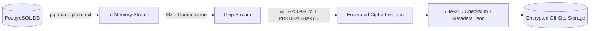

# ANESA CAMPUS OS — BACKUP & DISASTER RECOVERY RUNBOOK
**Target Release**: `v1.0.0-rc.1`
**Classification**: Enterprise Business Continuity & Disaster Recovery (BCDR) Standard Operating Procedure
**RPO Objective**: <= 1 hour (Point-in-Time WAL archiving)
**RTO Objective**: <= 30 minutes (Cold snapshot restore & integrity verification)

---

## 1. Overview & Cryptographic Architecture

The Anesa Campus OS backup system ([backup-manager.ts](../../../backend/tools/backup/backup-manager.ts)) provides cryptographically authenticated, encrypted, tamper-evident snapshots. See also [Disaster Recovery Playbooks](../../runbooks/disaster-recovery-and-incident-playbooks.md).



### Protection Invariants:
1. **Authenticated Encryption**: Uses `AES-256-GCM` with a 96-bit unique IV and 128-bit authentication tag. Tampering with even a single bit causes an immediate authenticated cipher failure during restore.
2. **Key Derivation**: Uses PBKDF2 with HMAC-SHA-512 and 100,000 iterations from a dedicated master backup passphrase (`BACKUP_ENCRYPTION_KEY`).
3. **Safety Protection Guards**:
   - The backup CLI explicitly refuses to restore snapshots into `campusos_demo` or any non-disposable database without explicit production override flags.
   - Prevents accidental overwrites of live institutional databases.

---

## 2. Automated Scheduled Backups

### Backup Schedule Configuration
Add to system cron (`/etc/cron.d/campusos-backup`):
```cron
# Full Encrypted Database Backup Daily at 02:00 AM
0 2 * * * campusos /opt/campusos/scripts/run-backup.sh >> /var/log/campusos/backup.log 2>&1

# Prune Backups Older Than 30 Days Daily at 03:30 AM
30 3 * * * campusos /opt/campusos/scripts/prune-backups.sh >> /var/log/campusos/backup.log 2>&1
```

### Script: `/opt/campusos/scripts/run-backup.sh`
```bash
#!/usr/bin/env bash
set -euo pipefail

BACKUP_DIR="/var/backups/campusos"
mkdir -p "$BACKUP_DIR"
cd /opt/campusos/backend

echo "Starting automated encrypted backup: $(date -u)"
export BACKUP_ENCRYPTION_KEY="$(cat /etc/campusos/backup.key)"
pnpm exec tsx tools/backup/cli.ts create --output-dir "$BACKUP_DIR"

# Sync to encrypted off-site cloud storage (e.g. AWS S3 Glacier or Cloudflare R2)
aws s3 sync "$BACKUP_DIR" s3://campusos-backups-offsite/$(date +%Y-%m)/ --sse AES256

echo "Backup completed and synced off-site: $(date -u)"
```

---

## 3. Backup Verification & Integrity Auditing

Before any snapshot is trusted, its checksum and cryptographic authentication tag must be verified.

### Verification CLI Command
```bash
cd /opt/campusos/backend
export BACKUP_ENCRYPTION_KEY="$(cat /etc/campusos/backup.key)"
pnpm exec tsx tools/backup/cli.ts verify --manifest /var/backups/campusos/backup-2026-11-24T02-00-00.json
```

**Expected Output**:
```
Validating backup integrity for manifest: /var/backups/campusos/backup-2026-11-24T02-00-00.json
  [OK] SHA-256 Checksum verified: 8f3c...
  [OK] AES-256-GCM authentication tag verified.
  [OK] Gzip decompression stream verified.
  [OK] SQL structural grammar check passed (Table count: 48, Migrations count: 55).
Integrity status: PASSED
```

If the snapshot has been altered or corrupted in transit, the verification fails closed:
```
ERROR: Authenticated decryption failed. Ciphertext authentication tag mismatch or corrupted file.
```

---

## 4. Disaster Recovery & Restoration Procedures

### Scenario A: Full Infrastructure Rebuild on a Clean Host
1. **Provision Clean PostgreSQL 16 Instance**:
   Ensure database `campusos_prod` is created with UTF-8 encoding.
2. **Retrieve Backup Snapshot**:
   Download target `.aes` and `.json` manifest from off-site storage.
3. **Execute Controlled Restore**:
   ```bash
   cd /opt/campusos/backend
   export DATABASE_ADMIN_URL="postgres://app_owner:<PASS>@localhost:5432/campusos_prod"
   export BACKUP_ENCRYPTION_KEY="$(cat /etc/campusos/backup.key)"

   pnpm exec tsx tools/backup/cli.ts restore \
     --manifest /var/backups/campusos/backup-target.json \
     --target-database campusos_prod \
     --confirm
   ```
4. **Post-Restore Integrity Checks**:
   - Check database connectivity and migration version:
     ```bash
     psql "$DATABASE_ADMIN_URL" -c "SELECT max(id) FROM app.schema_migrations;"
     ```
   - Verify table counts and active tenant count:
     ```bash
     psql "$DATABASE_ADMIN_URL" -c "SELECT count(*) FROM app.organizations WHERE status = 'ACTIVE';"
     ```
5. **Start Application Services**:
   ```bash
   sudo systemctl start campusos-api
   ```
6. **Execute Health Probe**:
   ```bash
   curl -f http://127.0.0.1:4000/api/v1/monitoring/health
   ```

---

## 5. Automated DR Rehearsal Frequency

- **Synthetic DR Rehearsals**: Executed automatically during CI test suite runs against disposable PostgreSQL instances ([backup-dr-and-monitoring.test.ts](../../../backend/tests/integration/backup-dr-and-monitoring.test.ts)).
- **Production Pilot DR Drills**: Required bi-weekly during pilot phase, validating off-site snapshot retrieval, decryptability, and zero-loss restore.
