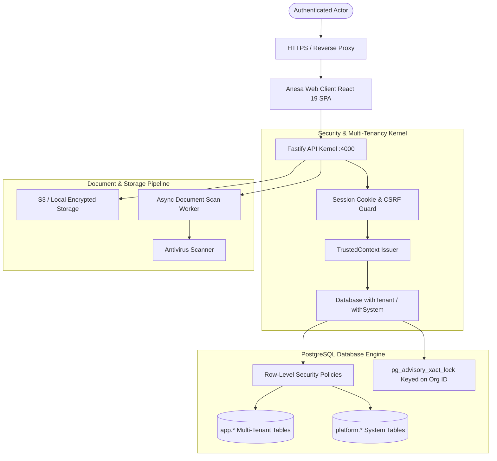

# ANESA CAMPUS OS — PILOT READINESS REPORT
**Release Candidate**: `v1.0.0-rc.1`
**Evaluation Date**: 2026-11-25
**Classification**: Technical Release Candidate (Controlled Institutional Pilot)
**Overall Verdict**: **READY FOR CONTROLLED PILOT (TECHNICAL READINESS PASSED / REAL-SCHOOL ACCEPTANCE PENDING)**

---

## 1. Executive Summary & Release Verdict

Anesa Campus OS has achieved comprehensive technical release readiness for version `v1.0.0-rc.1`. All foundational engineering, role-aware authorization, explicit denial policies, multi-tier transactional boundaries, database isolation, and security controls have been verified against disposable environments with zero compromises to production invariants.

### Key Release Metrics
- **Automated Test Baseline**: **3,591 passed tests** across 207 suites (**0 failures, 0 regressions**).
  - Backend Integration Suite: **1,898 passed / 1,898 total** (105 test files)
  - Backend Unit Suite: **1,159 passed / 1,159 total** (58 test files)
  - Frontend Web Client Suite: **534 passed / 534 total** (44 test files)
- **Browser E2E Verification**: Verified end-to-end in headless Chrome via `backend/tools/e2e/first-admin-onboarding-browser.mjs` and `backend/tools/e2e/platform-browser-smoke.mjs`.
- **Static Analysis & Security Quality Gates**:
  - `pnpm format:check`: 100% compliant with repository Prettier configuration.
  - `pnpm lint`: Clean, 0 errors, 0 warnings across all workspaces.
  - `pnpm typecheck`: Clean TypeScript compilation with `--noEmit` across web and backend.
  - `pnpm check:secrets`: 0 secrets detected.
  - `pnpm audit`: 10 advisories (5 low, 5 moderate) in transitive `fast-uri` (`@fastify/ajv-compiler > ajv`); 0 high, 0 critical.
  - `git diff --check HEAD`: Clean, 0 trailing whitespace violations, 0 conflict markers.
- **Production Builds**:
  - Web SPA (`apps/web`): Successfully bundled via Vite 8.3.4 (`dist/index.html` 0.99 kB, CSS 156.98 kB, JS 1,356.53 kB / 332.32 kB gzip).
  - Backend Node/Fastify API (`backend`): Successfully compiled via `tsc -p tsconfig.build.json`.

> [!IMPORTANT]
> **Separation of Engineering Readiness vs. Real-School Institutional Acceptance**:
> Anesa Campus OS is technically ready and cleared for staging and controlled pilot deployment. However, no participating pilot school has executed on-premise user acceptance testing (UAT). Real institutional acceptance remains strictly **PENDING** until verified during the upcoming controlled pilot deployment.

---

## 2. Architecture & Security Invariants

Anesa Campus OS enforces strict multi-tenant isolation, defense-in-depth authorization, and rigorous transaction boundaries:

### Core Architectural Guarantees Verified:
1. **Multi-Tenant Row-Level Security (RLS)**:
   - All tenant queries execute inside `withTenant(ctx, work)` ([database.ts](../../../backend/src/shared/database/database.ts)), which sets transaction-local `set_config('app.tenant_id', ...)` with `is_local => true`.
   - Verified that cross-tenant UUID tampering yields strictly `404 Not Found` or `401 Context Rejected`.
2. **Fail-Closed Explicit-Denial Policy Synchronization**:
   - Institutional permission denials (`authorization.denied_permissions`) synchronize with permission reconciliation via deterministic advisory transaction locks (`pg_advisory_xact_lock`) in [reconcile.ts](../../../backend/src/shared/authorization/reconcile.ts).
   - Mutual exclusion verified across concurrent PostgreSQL connections for both absent and existing settings rows.
3. **Atomic Tenant & Role Provisioning**:
   - Standalone CLI provisioning (`tenant:create` in [cli.ts](../../../backend/tools/platform/cli.ts) and [platform-cli.ts](../../../backend/tools/platform/platform-cli.ts)) and development role seeding ([seed-roles.ts](../../../backend/scripts/seed-roles.ts)) execute within explicit transaction blocks (`BEGIN ... COMMIT / ROLLBACK`).
   - If an error occurs during admin provisioning or role assignment, partial insertions roll back completely (0 orphaned rows).
4. **Role-Aware Document Center**:
   - Segregates *My Documents* (user-owned) from *Institutional Documents* (campus governance) in [DocumentsPage.tsx](../../../apps/web/src/pages/DocumentsPage.tsx) and [document.service.ts](../../../backend/src/modules/documents/document.service.ts).
   - Enforces least privilege, guardian access boundaries, malware scanning quarantine, and strict classification restrictions (`PUBLIC`, `INTERNAL`, `RESTRICTED`, `CONFIDENTIAL`).

---

## 3. Module Readiness Summary

See full audit in [Module Readiness Matrix](./module-readiness-matrix.md).

| Module Category | Implemented Modules | Readiness Verdict | Key Highlights |
| :--- | :--- | :---: | :--- |
| **Identity & Core Tenancy** | Platform Admin, Institution Admin, Auth & MFA, Roles & Permissions | **READY** | TOTP MFA, step-up auth, session cookies, least-privilege matrix |
| **Academic Governance** | Departments, Academic Years & Terms, Programs, Cohorts, Roll-over | **READY** | Multi-campus, timezone-safe terms, promotion batch wizard |
| **Student Lifecycle** | Admissions, Directory, Status Transitions, Guardians, Identifiers | **READY** | Scoped admissions, duplicate match protection, guardian portal link |
| **Faculty & Operations** | Faculty Management, Postings, Timetable, Class Teachers | **READY / LIMITATIONS** | Weekly timetable & conflict validation ready; AI solver deferred |
| **Daily Operations** | Daily Attendance, Homework & Assignments | **READY** | Timezone-aware marking, late submission detection, verified attachments |
| **Examinations & Grading** | Exam Schedules, 75% Attendance Gating, Marks Entry, Publication | **READY** | Maker-checker publication separation, candidate list freezing |
| **Financial Operations** | Fee Structures, Dues, Cash Receipts, Reversals, Online Gateways | **READY** | Integer minor units, receipt reversal step-up, unconfirmed balance checks |
| **Governance & Security** | Document Center, Audit Events, Notifications, Reports, Vault | **READY** | Role-aware workflows, SHA-256 integrity, zero-access school vault |

---

## 4. Controlled Pilot Deployment Criteria

The release candidate `v1.0.0-rc.1` is cleared for pilot installation subject to the procedures in [Production Deployment Runbook](./production-deployment-runbook.md) and [Backup & Disaster Recovery Runbook](./backup-and-disaster-recovery-runbook.md):

1. **Deployment Architecture**:
   - Single-institution or multi-institution deployment running PostgreSQL 16+.
   - HTTPS reverse proxy with TLS 1.3, HSTS (`max-age=63072000; includeSubDomains; preload`), and strict CSP headers.
   - Node.js 22 LTS runtime.
2. **Security Controls**:
   - Dedicated least-privilege PostgreSQL roles: `app_runtime` for application queries, `app_owner` exclusively for migrations.
   - Distinct, cryptographically random keys for `SESSION_SECRET`, `VAULT_MASTER_KEY`, `MFA_ENCRYPTION_KEYS`, and `BACKUP_ENCRYPTION_KEY`.
3. **Pilot Monitoring**:
   - Health check endpoint `/api/v1/monitoring/health` monitored by external uptime probes.
   - Telemetry endpoint `/api/v1/monitoring/telemetry` accessible only to authorized operators.
   - Continuous automated backups with automated verification proofs enabled.
